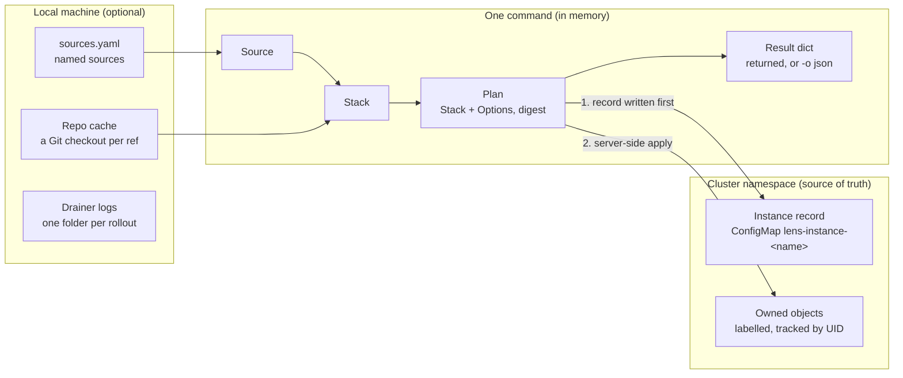
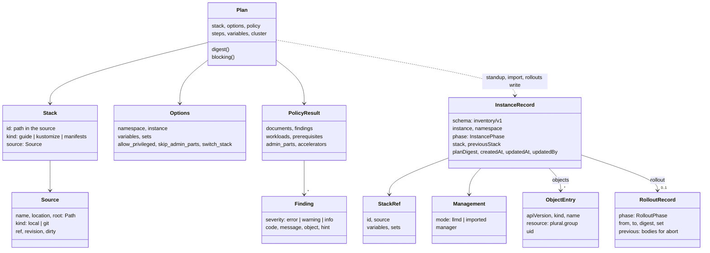
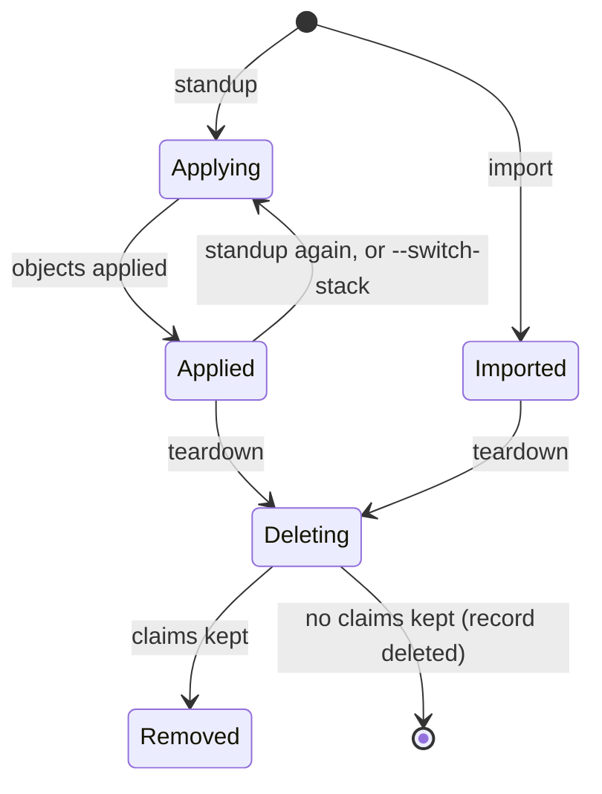
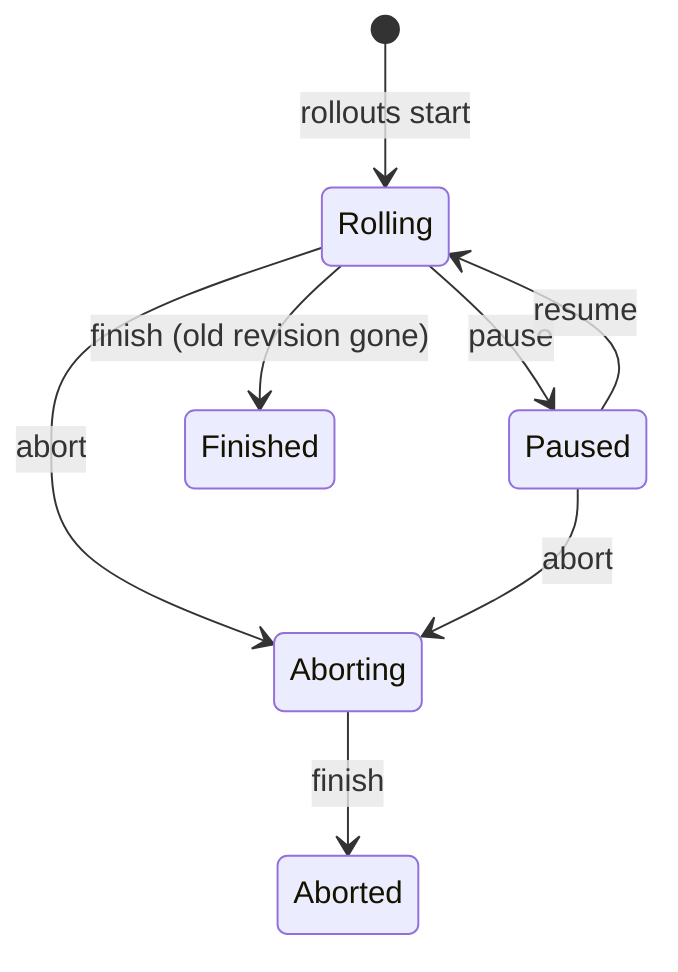

# Lens CLI State Model

Status: proposed (November 2026). Owner: Lens maintainers.

## Summary

This proposal makes the Lens CLI's state model explicit: 3 places state lives, 8 core datatypes, and 1 versioned record that every interface reads. Most of the model already exists in the merged `llmd` code (#107). In-memory values are frozen dataclasses, but the persisted instance record (`lens.llm-d.ai/inventory/v1`) is an untyped `dict`. The main proposal is to give that record and its rollout section typed definitions and a published JSON Schema, using only the standard library.

**Scope:** `apps/lens` only. **Decision needed:** approve the typed record ([Proposed changes](#proposed-changes)) before `serve` or new lifecycle ops build on it.

## Context and scope

The roadmap makes the CLI the backend: one engine, called from the CLI, a Python import, and later a REST `serve` layer (see [repository-layout.md](repository-layout.md)). All three must agree on what an instance is. Today that agreement lives in code paths that build `dict`s by hand (`lifecycle.standup`, `importing.import_stack`, `rollouts.engine.start`), so the record's shape is only documented by reading them.

**Goals**

- Name every datatype that carries CLI state, with its fields, types and invariants.
- Give the persisted instance record one typed definition and a machine-readable schema.
- Define the record's phases and transitions as a state machine.
- Define one JSON contract shared by `llmd -o json`, the Python API and `serve`.
- Keep the engine dependency-free beyond PyYAML (the boundary test stays green).

**Non-goals**

- No database. The cluster stays the source of truth for instances.
- No change to the legacy service's data model (`llm_d_lens/db`).
- No new lifecycle operations; this covers the state the existing ones use.
- Not choosing a REST framework for `serve`.

## Where state lives

CLI state sits in three places, and only one of them must survive. A command builds its values in memory from local sources, then writes the instance record to the cluster before it applies any object.



Any machine with kube access can run `status`, `rollouts` or `teardown`, because all three read the record, not local files.

## Core datatypes

Every command turns a `Source` and `Options` into a `Plan`. Standup, import and rollouts then write one `InstanceRecord`, which every later command reads.



The in-memory types (top six) are already dataclasses. The persisted types are only `dict`s today; `StackRef` and `Management` are the names this proposal gives to sub-objects the code already writes.

## Type reference

Six of the eight types are already typed in code; the two persisted ones (`InstanceRecord`, `RolloutRecord`) are `dict[str, Any]`. Everything below is read from `apps/lens/lens/` as merged.

| Type | Defined in | Form today | Lifetime | Key fields |
| --- | --- | --- | --- | --- |
| `Source` | `sources.py` | frozen dataclass | one command | `name`, `location`, `root: Path`, `kind: local\|git`, `ref`, `revision`, `dirty: bool` |
| `Stack` | `catalog.py` | frozen dataclass | one command | `id` (path in source, e.g. `guides/optimized-baseline`), `kind: guide\|kustomize\|manifests`, `source: Source` |
| `Options` | `plan.py` | dataclass | one command | `namespace`, `instance`, `allow_privileged`, `skip_admin_parts`, `switch_stack`, `variables: dict[str,str]`, `sets: list[str]` |
| `Plan` | `plan.py` | dataclass | one command | `stack`, `options`, `command`, `policy: PolicyResult`, `cluster`, `steps`, `variables`; derived `digest`, `blocking` |
| `PolicyResult` | `policy.py` | dataclass | inside `Plan` | `documents`, `findings`, `prerequisites`, `workloads`, `admin_parts`, `source_namespaces`, `accelerators: dict[str,int]` |
| `Finding` | `model.py` | frozen dataclass | inside `Plan` | `severity: error\|warning\|info`, `code`, `message`, `object`, `hint` |
| `InstanceRecord` | `inventory.py` (built in `lifecycle.py`, `importing.py`) | `dict` | persisted, until teardown | see the field table below |
| `RolloutRecord` | `rollouts/engine.py` | `dict` inside the record | persisted, per rollout | see the field table below |

Derived views are computed on each read and never stored: `status.instance_status` (health), `rollouts.progress.Progress` / `RoleProgress` / `Group` (dataclasses, per DisaggregatedSet), and `Plan.summary()` (the `llmd plan -o json` output).

### `InstanceRecord` fields

Stored as JSON under key `inventory.json` in ConfigMap `lens-instance-<instance>`, in the instance's namespace.

| Field | Type | Set by | Invariant |
| --- | --- | --- | --- |
| `schema` | `"lens.llm-d.ai/inventory/v1"` | all writers | Must match, or the record is refused (`ConflictError`) |
| `instance` | `str` | standup, import | DNS label, at most 40 characters; equals the ConfigMap's instance label |
| `namespace` | `str` | standup, import | Equals the ConfigMap's namespace |
| `management` | `{mode: "llmd"\|"imported", manager?: str}` | standup, import | `imported` instances are never stood up or labelled |
| `phase` | `Applying\|Applied\|Imported\|Deleting\|Removed` | lifecycle ops | See [Instance lifecycle](#instance-lifecycle) |
| `stack` | `{id, source: Source.describe(), variables?, sets?}` | standup, import, rollout start | Changes only with `--switch-stack` or a rollout |
| `previousStack` | same shape as `stack` | standup with `--switch-stack` | Kept across later standups |
| `planDigest` | `str` (hex) | standup, rollout start | Digest of namespace + instance + rendered objects |
| `objects` | `list[ObjectEntry]` | standup, import, rollout | Written before the first apply; teardown deletes newest first |
| `rollout` | `RolloutRecord` | rollout ops | At most one; see below |
| `createdAt`, `updatedAt` | ISO 8601 UTC (`Z`) | all writers | `updatedAt` set on every write |
| `updatedBy` | `str` | standup, import | The kube user from the plan's cluster check |

`ObjectEntry` = `{apiVersion, kind, name, resource, uid?}`. `resource` is `plural.group`; `uid` is set after apply and checked before any delete.

### `RolloutRecord` fields

| Field | Type | Meaning |
| --- | --- | --- |
| `phase` | `Rolling\|Paused\|Aborting\|Finished\|Aborted` | `Rolling`, `Paused`, `Aborting` count as in progress |
| `startedAt`, `startedBy`, `pausedAt`, `abortedAt`, `finishedAt` | ISO 8601 / `str` | Audit times |
| `from`, `to` | `Source.describe()` | The source ref before and after |
| `digest` | `str` | The rollout plan's digest |
| `set`, `fromRevision` | `str` | The DisaggregatedSet that rolls and its old revision |
| `objects` | `list[str]` (`Kind/name`) | What the rollout changes |
| `previous` | `list[{resource, document}]` | Bodies before the change; what `abort` re-applies. Never Secrets |
| `drain` | `str` | The `--drain` command template, or empty |
| `steps` | `list` | Steps taken so far |

## Instance lifecycle

The record has two phase fields, and both are already written by the merged code. `phase` tracks the instance; `rollout.phase` tracks the one rollout that may run on an `Applied` or `Imported` instance. `Rolling`, `Paused` and `Aborting` count as a rollout in progress, which blocks `--switch-stack` and a second rollout.

`InstancePhase` (`record.phase`). `llmd teardown --forget` deletes the record from any state.



`RolloutPhase` (`record.rollout.phase`):



Health (`Ready`, `Progressing`, `Degraded`, `Failed`, `Unknown`, `Missing`) is a third dimension. `llmd status` derives it from live objects on every read and never stores it, so it is not a phase. Under this proposal the transitions above become the allowed-transition table checked on each write.

## Persistence, versioning and the JSON contract

State is persisted in exactly two places, and only the in-cluster record is needed for correctness. Losing the laptop loses registered source names and drainer logs, never the knowledge of what an instance owns.

| Store | Path / object | Format | Written by | Needed for correctness |
| --- | --- | --- | --- | --- |
| Instance record | ConfigMap `lens-instance-<name>`, key `inventory.json`, labels `app.kubernetes.io/managed-by=llm-d-lens`, `lens.llm-d.ai/instance`, `lens.llm-d.ai/role=inventory` | JSON, sorted keys | `inventory.write` (server-side apply) | Yes |
| Source registry | `$LLMD_STATE_DIR` or `$LENS_DATA_DIR/llmd/sources.yaml` | YAML, atomic write | `SourceRegistry` | No |
| Drainer logs | `$LENS_DATA_DIR/llmd/rollouts/<ns>/<instance>/` | text | `rollouts.drainers` | No |
| Repo cache | `$LENS_CACHE_DIR/repos` | Git checkouts | `sources.resolve_source` | No |

**Integrity rules already enforced.** A record is refused unless its `schema`, labels, name and namespace all agree. The record is written before the first apply, so an interrupted standup can still be torn down. Every delete checks the recorded UID first. A plan's digest is SHA-256 over sorted JSON of namespace, instance and rendered objects; `--expected-digest` takes the full value or its first 16 characters.

**Versioning.** The schema string `lens.llm-d.ai/inventory/v1` is the version. Proposed rule: adding an optional field stays `v1`; renaming, removing or changing a field's type makes `v2`. Readers accept `v1` and `v2` for one release, and a write always uses the newest.

**One JSON contract.** Every operation returns a JSON-serializable `dict`; `llmd -o json` prints it, and `serve` would return it as the response body. Failures map one-to-one:

| Error class | `code` | Exit code | HTTP status |
| --- | --- | --- | --- |
| `UsageError` | `invalid_request` | 2 | 400 |
| `PolicyError` | `plan_blocked` | 3 | 422 |
| `ConflictError` | `conflict` | 4 | 409 |
| `CommandError` | `command_failed` | 5 | 502 |
| `NotFoundError` | `not_found` | 6 | 404 |
| `NotReadyError` | `not_ready` | 7 | 504 |

Gap: with `-o json`, the CLI still prints errors as text on stderr. `LlmdError.as_problem()` exists but no command emits it.

## Proposed changes

Five changes, all inside `apps/lens` and all standard library, so the PyYAML-only dependency rule holds. None changes the record's JSON on disk; existing `v1` records stay readable.

1. **Type the persisted record.** Add `lens/records.py` with frozen dataclasses `InstanceRecord`, `ObjectEntry`, `Management`, `StackRef` and `RolloutRecord`, each with `from_dict()` (validating) and `to_dict()`. `inventory.parse` returns an `InstanceRecord`; `lifecycle`, `importing` and `rollouts.engine` build one instead of a literal `dict`.
2. **Make phases enums.** `InstancePhase` (`Applying`, `Applied`, `Imported`, `Deleting`, `Removed`) and `RolloutPhase` (`Rolling`, `Paused`, `Aborting`, `Finished`, `Aborted`) as `StrEnum` (Python 3.11+), with the allowed transitions as a table checked on write. `Finding.severity` and `Stack.kind` become enums too.
3. **Publish a JSON Schema.** Ship `lens/schemas/inventory-v1.schema.json` and add `llmd schema inventory` to print it. A test checks that it matches `records.py` both ways; `jsonschema` is a dev-only dependency for that test.
4. **Emit errors in JSON.** With `-o json|yaml`, print `as_problem()` on stdout and keep the exit code. The CLI and `serve` then return the same error body.
5. **Type operation results.** Give each op's return value a small dataclass (`StandupResult`, `TeardownResult`, `InstanceStatus`, …) with `to_dict()`, so the `-o json` output is a documented contract, not whatever the handler built.

Sketch of change 1 (shape only; field names are today's):

```python
class InstancePhase(StrEnum):
    APPLYING = "Applying"
    APPLIED = "Applied"
    IMPORTED = "Imported"
    DELETING = "Deleting"
    REMOVED = "Removed"


@dataclass(frozen=True)
class ObjectEntry:
    api_version: str  # JSON: apiVersion
    kind: str
    name: str
    resource: str     # plural.group
    uid: str = ""


@dataclass(frozen=True)
class InstanceRecord:
    SCHEMA: ClassVar[str] = "lens.llm-d.ai/inventory/v1"

    instance: str
    namespace: str
    management: Management
    phase: InstancePhase
    stack: StackRef
    plan_digest: str
    objects: tuple[ObjectEntry, ...]
    created_at: str
    updated_by: str = ""
    updated_at: str = ""
    previous_stack: StackRef | None = None
    rollout: RolloutRecord | None = None

    @classmethod
    def from_dict(cls, data: dict[str, Any]) -> InstanceRecord: ...  # raises ConflictError

    def to_dict(self) -> dict[str, Any]: ...  # camelCase keys, as stored today
```

## Alternatives considered

| Option | For | Against | Verdict |
| --- | --- | --- | --- |
| Stdlib dataclasses + hand-written JSON Schema (proposed) | No new runtime dependency; matches the existing frozen dataclasses | Validation code written by hand; schema can drift (a test guards it) | Recommended |
| Pydantic models | Validation and JSON Schema for free; FastAPI already speaks it | Adds a runtime dependency to an engine meant to install with PyYAML only, including in-cluster Jobs | Reconsider if `serve` adopts FastAPI |
| `TypedDict` only | Zero runtime cost; types the existing `dict`s in place | No runtime validation; records edited by hand in the cluster pass silently | Too weak for a record the cluster can change |
| A CustomResourceDefinition instead of a ConfigMap | Server-side schema validation; `kubectl get lensinstances` | Installing a CRD needs cluster-admin, which the engine is built to avoid | Rejected for now |
| Protobuf / gRPC types | Strong cross-language contract | New toolchain; no non-Python consumer today | Rejected |

## Review and rollout

1. **Review this PR.** Settle the open points below in review comments.
2. **Decide in team sync.** Record the decision here (`Status: accepted`, date, who decided) and merge.
3. **Implement in small PRs**, one per proposed change, each linking this doc: records + enums, schema + `llmd schema`, JSON errors, typed results.
4. **Keep it current.** Any PR that changes the record's shape updates this doc and the schema file in the same change; the schema test enforces the second.

Open points for reviewers:

- [ ] Keep camelCase JSON keys (as stored today) with snake_case Python fields, or switch storage to snake_case under `v2`?
- [ ] Enforce phase transitions on write (refuse) or only log a warning?
- [ ] Should `llmd list` keep showing unreadable records as `phase: Invalid`, or report them separately?
- [ ] Is a `jsonschema` dev dependency acceptable, or should the schema test compare by hand?
